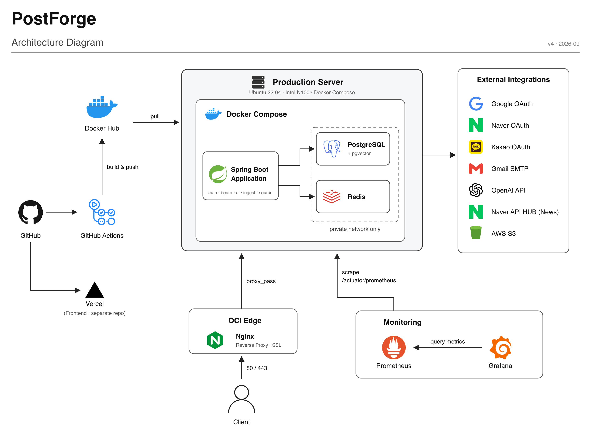

# PostForge

> 게시판 서비스 백엔드 — 구현·측정·트러블슈팅을 기술 블로그 글로 남기는 프로젝트

PostForge는 회원가입·로그인과 게시글·댓글·좋아요·조회수를 갖춘 게시판 서비스의 백엔드입니다.
구현하면서 겪은 문제와 부하 측정 결과를 기술 블로그 글로 남깁니다. 학습 플랫폼은 `release/postforge-study` 브랜치에서 따로 진행하며, 이 브랜치에서 떼어 낸 근거는 [ADR-009](./docs/decisions/adr-009-split-study-from-board.md)에 있습니다.

## 핵심 기능

| 영역 | 현재 구현 |
| --- | --- |
| 인증 | JWT, Redis refresh token rotation, OAuth2, 이메일 인증, 로그인 보호 |
| 게시판 | 게시글, 댓글/대댓글, 좋아요, 조회수, 작성자 소유권 검증 |
| AI | Spring AI, OpenAI-compatible LLM 호출 경로(`TextGenerationClient`). 아직 이를 쓰는 기능은 없다 |
| 운영 기반 | Flyway baseline, Docker layered jar, requestId 로그, Prometheus/Grafana |

뉴스 수집·자동 게시·데일리 종합, 그 시절의 초안 생성기·RAG 채팅·문서 적재·첨부파일은 ADR-008에 따라 지웠습니다. 학습 기능은 ADR-009에 따라 이 브랜치에서 뗐습니다.

## Architecture



다이어그램 원본은 [PostForge_Architecture_v4.svg](./docs/images/PostForge_Architecture_v4.svg)다. 그림은 ADR-008 전환 전 뉴스 자동 게시 시절의 구조다.

6개 Gradle 모듈로 구성된 DDD-lite 모듈러 모놀리스입니다.

- `app`: 실행 조립과 route/security/OpenAPI 정책
- `core`: 모듈 간 port, DTO, 오류 및 principal 계약
- `support`: Redis, JPA auditing, 요청 로깅, 공통 MVC 예외 응답
- `auth`, `board`, `ai`: 기능별 소유권

기능 모듈은 서로의 구현 대신 port 또는 공개 application API를 사용하고, 의존성 방향은
`ModuleBoundaryTest`로 검증합니다.

- [모듈 책임과 의존 방향](./docs/architecture/module-dependencies.md)
- [모듈별 요청 처리 흐름](./docs/architecture/flows.md)
- [모듈러 모놀리스 선택과 MSA 전환 경로](./docs/decisions/adr-003-modular-monolith.md)
- [관측 스택 선택과 대안 비교](./docs/decisions/adr-006-observability-stack.md)

## Tech Stack

| 영역 | 기술 |
| --- | --- |
| Runtime | Java 21, Spring Boot 3.5.14, Gradle 8.14.3 |
| Data | PostgreSQL, Redis, Spring Data JPA, Flyway |
| Security | Spring Security, JWT, OAuth2, Gmail SMTP |
| AI | Spring AI 1.0.7, OpenAI-compatible API |
| API | Spring MVC, SpringDoc OpenAPI |
| Test | JUnit 5, Spring Boot Test, ArchUnit |
| Operations | Docker Compose, GitHub Actions, Prometheus, Grafana, MDC requestId logging |

## Data And API

테이블·Redis key 소유권은 [DB Schema Ownership](./docs/database/schema-ownership.md)이 정본입니다.
관계 시각화는 [MVP ERD](./docs/database/postforge-mvp-erd.md)를 봅니다.

신규 DB는 Flyway `V0000__baseline_schema.sql`부터 차례로 적용해 만듭니다. 2026-09-30 이력을 리셋했고([ADR-007](./docs/decisions/adr-007-remove-naver-news-source.md)), 2026-10-02 뉴스 퇴역 끝에 학습 표를 합쳐 동결했고([ADR-008](./docs/decisions/adr-008-switch-to-learning-platform.md)), 2026-10-19 `V0001`로 그 학습 표를 지웠습니다([ADR-009](./docs/decisions/adr-009-split-study-from-board.md)). 이후 변경은 `V0002`부터 쌓습니다.
옛 이력이 적용된 DB는 고쳐 쓰지 않고 DB를 지우고 다시 만듭니다. 로컬은 `docker exec postforge-db sh -c 'psql -U "$POSTGRES_USER" -d postgres -c "drop database postforge" -c "create database postforge"'` 뒤 재기동, 계정·게시글은 `scripts/local-demo-seed.sql`로 다시 넣습니다.
모든 프로필은 `ddl-auto=validate`로 entity와 schema의 일치만 검증합니다.

Endpoint, DTO, status, 인증 조건의 정본은 [API 명세](./docs/api/README.md)입니다.
관리자 권한은 기존 ADMIN이 `PUT /api/admin/accounts/{accountId}/roles/admin`으로 다른 활성 계정에 부여할 수 있습니다.
최초 ADMIN은 DB에서 지정해야 하며, 승격된 계정은 다시 로그인하거나 토큰을 재발급받아야 합니다.
실행 중에는 [Swagger UI](http://localhost:8080/swagger-ui.html)에서 현재 OpenAPI schema를 확인할 수 있습니다.

## Local Run

필수 도구는 Java 21+, Docker Compose입니다.

설정은 세 층입니다. `application.yml`은 공통이고, `application-local.yml`·`application-prod.yml`에는 환경마다 값이
달라야 하는 항목(DB·Redis 호스트, LLM 주소·모델 기본값, 메일 서버, 프록시 헤더)만 둡니다. 프로필을 지정하지 않으면
`local`이며, 운영은 `SPRING_PROFILES_ACTIVE=prod`로 바꿉니다.

| | local | prod |
| --- | --- | --- |
| 프로필 설정 | `application-local.yml` (커밋) | `application-prod.yml` (커밋 안 함, 배포 호스트에서 컨테이너에 마운트) |
| 환경변수 | `.env.local` (커밋 안 함) | `.env` (커밋 안 함, compose `env_file`) |
| compose | `docker-compose.local.yml` (커밋) | `docker-compose.prod.yml` (커밋 안 함) |

[`.env.example`](./.env.example)은 두 환경에서 쓰는 변수명만 값 없이 나열합니다. 로컬은 주소·DB 계정·JWT·소셜 로그인·
모니터링 값만 채우면 됩니다. LLM 주소·모델, Redis 호스트·포트, CORS 허용 origin은 설정 기본값(Ollama `localhost:11434`의
`qwen3:8b`, Redis `localhost:6379`, CORS는 `APP_FRONTEND_BASE_URL` 값)을 쓰므로 복사한 `.env.local`에서 `LLM_GATEWAY_BASE_URL`·
`LLM_CHAT_MODEL`·`REDIS_HOST`·`REDIS_PORT`·`APP_CORS_ALLOWED_ORIGINS` 줄을 지웁니다. `KEY=`처럼 값 없이 남기면 빈 문자열이
기본값을 덮어 기동에 실패합니다. 메일 서버는 `application-local.yml`에 Mailpit `localhost:1025`로 고정돼 있어 `GMAIL_*`은
비워 둬도 됩니다.

```bash
cp .env.example .env.local                                               # 값 채우기
docker compose --env-file .env.local -f docker-compose.local.yml up -d   # PostgreSQL, Redis, Mailpit
./gradlew :app:bootRun                                                   # 프로필 local, 루트의 .env.local 을 읽음
```

첫 부팅 시 Flyway가 `db/migration`의 baseline(V0000)부터 적용해 스키마를 만들고, Hibernate는 `validate`로
엔티티와 스키마가 일치하는지만 검사합니다. 부팅 확인은 `curl localhost:8080/actuator/health`.
인증 메일은 실제로 발송되지 않고 [Mailpit](http://localhost:8025)에 쌓입니다. 데모 계정과 게시글은 `scripts/local-demo-seed.sql`로 넣습니다.

LLM 호출 경로는 로컬에서 Ollama를 직접 부르고 운영에서는 OpenAI-compatible gateway를 거치도록 설정돼 있습니다. 지금은 이를 쓰는 기능이 없어 로컬에서 Ollama를 띄우지 않아도 기동합니다. 두 환경 모두 공용 주소
`LLM_GATEWAY_BASE_URL`/`LLM_GATEWAY_TOKEN`과, 그보다 우선하는 개별 주소 `LLM_CHAT_BASE_URL`/`LLM_CHAT_API_KEY`로
덮어쓸 수 있습니다. 운영은 기본값이 없어 `LLM_GATEWAY_BASE_URL`, `LLM_CHAT_MODEL`이 빠지면 기동에 실패합니다.

```text
local: PostForge app -> Ollama(localhost:11434) -> qwen3:8b
prod:  PostForge app -> OpenAI-compatible LLM gateway -> Ollama -> qwen3:8b
```

운영 배포 호스트에는 `docker-compose.prod.yml`, `.env`, `application-prod.yml`을 같은 디렉터리에 둡니다. compose가
`application-prod.yml`을 `/app/config/`에 마운트하므로 이미지를 다시 만들지 않고 설정을 바꿀 수 있습니다.
`.env`는 예제가 바뀌어도 자동 갱신되지 않으므로 배포 시 새 항목만 병합하고 기존 비밀키는 유지합니다.
두 파일을 바꾼 뒤에는 앱 컨테이너를 재생성해야 반영됩니다.

## Test

```bash
# 전체 테스트
./gradlew test

# 태그 제외(쉼표로 여러 개). CI는 eval만 빼지만 지금 eval 태그 테스트는 없어 integration·persistence까지 모두 돈다
./gradlew test -PexcludeTags=integration,persistence

# 실행 jar 생성
./gradlew :app:bootJar -PexcludeTags=integration
```

테스트는 Testcontainers로 운영과 같은 PostgreSQL 이미지(`pgvector/pgvector:0.8.2-pg18-trixie`)를 띄워 Flyway 이력을 적용하고 `ddl-auto=validate`로 엔티티와 대조하므로 Docker가 필요합니다. 2026-10-02 로컬 기준 전체 테스트 426개가 H2일 때 37초, PostgreSQL 컨테이너로 51초 걸렸습니다.

이 저장소에는 현재 전용 부하 테스트 runner가 없습니다. 과거 k6/Bruno/Grafana/API smoke 산출물은
[성능 리포트](./docs/performance/README.md)에 historical evidence로 보관합니다.

## Docker And Deployment

이미지 빌드·게시는 수동 실행만 합니다. `release/postforge`에서 Actions의 APP-CI를 `workflow_dispatch`로 실행하면
테스트 성공 후 Spring Boot layered jar 기반 runtime image를 만들어 Docker Hub에 `latest`와 commit SHA tag로 게시합니다.
`release/postforge` push와 PR은 테스트만 돌리고 이미지를 만들지 않습니다. `Dockerfile.runtime`은 non-root 사용자로 실행하며
dependency와 application layer를 분리해 registry cache 효율을 높입니다.

```text
workflow_dispatch (release/postforge)
-> ./gradlew check -PexcludeTags=eval
-> ./gradlew :app:bootJar
-> Dockerfile.runtime
-> Docker Hub latest + commit SHA
```

## 문서

| 문서 | 설명 |
| --- | --- |
| [전체 문서 안내](./docs/README.md) | 정본 경계, 읽는 순서, 전체 분류 |
| [API 명세](./docs/api/README.md) | 모듈별 endpoint, DTO, status, 인증 조건 |
| [모듈 의존성](./docs/architecture/module-dependencies.md) | 모듈 책임과 dependency policy |
| [DB Schema Ownership](./docs/database/schema-ownership.md) | DB/Redis 소유권과 migration 규칙 |
| [성능 리포트](./docs/performance/README.md) | 현재 검증 표면과 historical evidence 구분 |

## License

No license file is currently included. Reuse and distribution are controlled by the repository owner.

